<pre>
                           .*/////////*/////,
                      .*//*****,,/******//////(%
                    /**,.                  ,,*//(/
                 ,*,.                            ,/(#
               *.                                   ,//%
             . .  .                                    ,//
           ,.. ...         ..                             */#
          ,.. ,,,.        ..,   ,/*///***,,                 ,/#
         ,,......      ...,,**///(/(((((###(///*,             ./
       .,..,.,.        ..    .,,*///(((/((((/////,              ,/
      .,,.., *(*.      ....,..   .,**..     .....*       .,*.     ,
      .,.,*,,..,,,  . .,... ...*. ,((/*,,...**(**/,  .   ,(**,(,  ,/
      ,*,,*.,*,  ... ...,....,,,, *(../**,/,.*//,/,..,   ./,((/.  ,/
      ,*,,//,,.,..  .,..,***/**,,.*((,/////////***.(**   ,**(#/...,*
      ,,,,,,/*/**,,. .%.,,****,..,/#(/*,,/////*/***//  .,,,.*/*.  **
      ,*,,/*,.,,,, .  ....,,,,.. .,*/,*,*,***,//*  .  .,,.,,**,, .,*
      .*,**((///*..   ...,,,...    ..,,*,*,*****, . ....**/****, .,*
    . ..,.,,**,..      ...,.     .... ....,,****,, .     ..,*,.,.,*//**#(((,
    ...  ,.. ,..        ...,,,....,,,,,///***** ,, ,,,...,.,*  ,.,**,,*////(
.,,,,,*,,.  ...,,..        .,,,**,***///////*,..,...*,,,,.,,*.,,. (.////.///*
,,,*,,*,**** .. ,,,...        .,,,***///*//*,...... *,,,,,,,***,* (*.//,*/////
*,*******,,*,*  . **,,..           ....,,,,..,. .* ..*.,,,,,,**/.,,.(.,,,*//,///
***,*,*******,*,..***,,..                     .  .    ,,,,,****/ .. #  .,,******
************,,*  ,****,,..               , ..,.,...  ,,,,*******      .,,,*,,,**
********,***,,   ,*,****,..  ...     ..,,,,,,**,*.  .,**.,******.  .(.,,,.,,,,,,
*****,,*,,,,,.. .,,,.,*,*,,.,..,. ..,,,,,,,*,***,   ..,*********   .*.    ......
******,,,,,,.   .,.,,***,,,,... ...,.,,**,**,*,.. . ,,********,,.   /..        .
*,.,*,,,,...  , .,,,,,,**,,.  .,.,        .....  ,,  ,, ., ,,,,,,   ..       ..,
,,,*,.,,,,.. ....,,,,,,,,,.. ..,,...,,.,,,,,,,.  .,,*,.,, .,,,,,,  *        ,**,
,,,,,....,.,.  ,..,,,,,,..  ,,,,,  .....,...,...,, ..,****,,,**,,              .
,,......,..,,,.,,,***,,..  ,,,,,,. .,*,.,,,.,,,*,,,,*********,,,,.    .  *
,,,..... ..,,, .,,,,,,,,.  *,,,,, ..,,, ,*...,,,,,,,*********,,,..       .
,,,,       ,,.,.,,,,.,,,.  ,,,.., ...,. .*,,.,*,,,,,*********,,,,.  .
,,,,      .  ,,,..  .,,,.  ,,,,,.  ....  ,*,..,,,,,,**. *,*,,,,,.     ,     *
,,..,          .., .,,,.   ,,,,,.. .,,...   .,,,,.,,., ,,,,......
...            ........   ,,..,., . ..,........................                *
</pre>

# Arohan Arora

**Electronics & computer science student in Delhi.**
Building rovers, combat robots, drones and satellite tooling, now heading into ML, agentic and autonomous systems.

 

<!-- cool-readme:start -->
<!-- Cards by github-cool-readme: https://github.com/pedrocatalao/github-cool-readme -->

<picture>
  <source media="(prefers-color-scheme: dark)" srcset="https://raw.githubusercontent.com/arungunayo/arungunayo/cards/summary-dark.svg">
  
</picture>
<picture>
  <source media="(prefers-color-scheme: dark)" srcset="https://raw.githubusercontent.com/arungunayo/arungunayo/cards/languages-dark.svg">
  
</picture>

<picture>
  <source media="(prefers-color-scheme: dark)" srcset="https://raw.githubusercontent.com/arungunayo/arungunayo/cards/contributions-dark.svg">
  
</picture>
<picture>
  <source media="(prefers-color-scheme: dark)" srcset="https://raw.githubusercontent.com/arungunayo/arungunayo/cards/streaks-dark.svg">
  
</picture>

<!-- cool-readme:end -->

 

### Now

- **[Mars Rover](https://roverchallenge.eu/team/team-vyomagami-2026/)**: rover for the European Rover Challenge and the International Rover Challenge
- **Combat robotics**: Fusion and Electronics
- **Agentic systems**: Notable: [Water-Zero](https://github.com/arungunayo/Water-Zero)
- **[TerraScansi](https://github.com/arungunayo/Terrascansi)**: satellite data tooling for urban heat, pollution and resource waste
- **Drones**: avionics and flight controller design
- **ImGui React**: a React-style reactive UI layer for C++ and Dear ImGui

 

[LinkedIn](https://www.linkedin.com/in/arohan-arora/) &nbsp;·&nbsp; [Email](mailto:projectsarungunayo@gmail.com)

